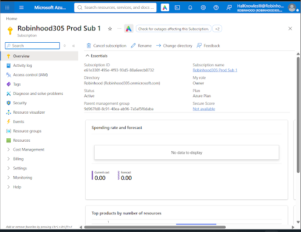
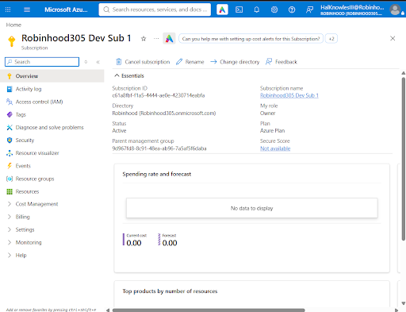
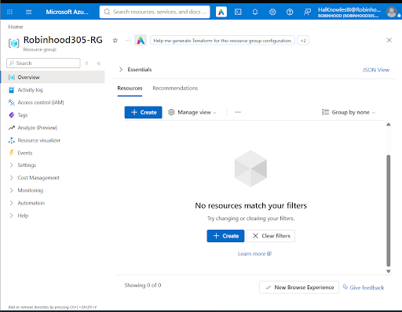
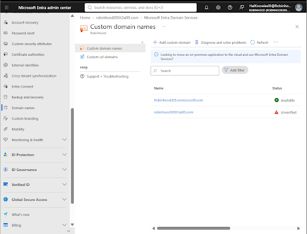
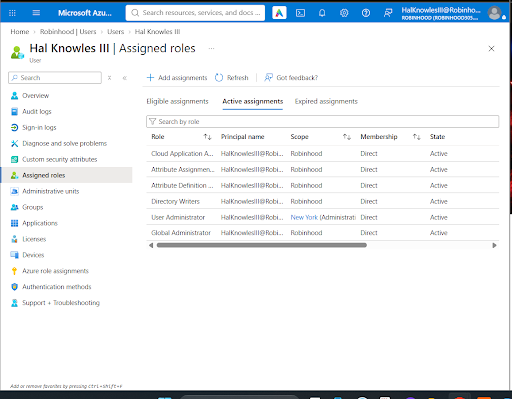

# Module 1: Identities & Governance (AZ-104 Portfolio Series)

---

## 📸 LAB 1: Multi-Subscription Architecture, Governance & Custom Domain Initialization

### 🎯 Objective & Overview
In this initial demo, I established the foundation of an enterprise Azure environment. The goal was to separate administrative workloads across multiple subscriptions while provisioning a custom domain and validating directory-level RBAC privileges within Microsoft Entra ID.

---

### 🔍 Screenshot Explanation & What Was Accomplished in Lab 1

#### 1. Dual-Subscription Segmentation (`Prod Sub 1` vs `Dev Sub 1`)
To prevent accidental resource modifications and isolate production charges from testing environments, I configured two distinct Azure Subscriptions under the primary directory (`Robinhood305.onmicrosoft.com`):

* **Production Subscription (`Robinhood305 Prod Sub 1`):** Dedicated to hosting live production environments and business-critical workloads.
* **Development Subscription (`Robinhood305 Dev Sub 1`):** Configured as a sandbox for testing, development, and staging deployments.

*Figure 1.1: Verification of `Robinhood305 Prod Sub 1` active under the Azure Plan linked to directory `Robinhood (Robinhood305.onmicrosoft.com)`.*

*Figure 1.2: Verification of `Robinhood305 Dev Sub 1` established for development workload isolation.*

---

#### 2. Logical Container Management (`Robinhood305-RG`)
Inside the subscription ecosystem, I created a primary Resource Group named **`Robinhood305-RG`**. This acts as a logical container to manage resource lifecycles, apply resource locks, and assign targeted access permissions.

*Figure 1.3: Creation of Resource Group `Robinhood305-RG` ready for resource deployment.*

---

#### 3. Custom Domain Registration (`robinhood305h3a0l5.com`)
To prepare for enterprise branding and allow users to sign in using `@robinhood305h3a0l5.com` instead of the default `.onmicrosoft.com` UPN suffix, I added **`robinhood305h3a0l5.com`** under **Custom domain names** in Microsoft Entra Admin Center.

> 💡 **Lab 1 Status Note (Unverified Domain):**
> As captured in Figure 1.4, `robinhood305h3a0l5.com` currently displays a status of **Unverified**. This is expected behavior at the end of Lab 1. Proof of domain ownership requires adding a public TXT/MX record at the DNS registrar level, which is executed step-by-step in **Lab 2**.

*Figure 1.4: Microsoft Entra Admin Center showing default domain `Robinhood305.onmicrosoft.com` alongside the pending `robinhood305h3a0l5.com` entry.*

---

#### 4. Directory Privilege & Role Verification
To ensure my account has appropriate governance and user management authority across the tenant, I verified active directory role assignments for **`Hal Knowles III`** (`HalKnowlesIII@Robinhood305.onmicrosoft.com`):

* **Global Administrator:** Full directory access across Microsoft Entra ID.
* **User Administrator:** Authority to create users, manage groups, and assign user licenses.
* **Supporting Roles:** Cloud Application Administrator, Directory Writers, and Attribute Definition roles.

*Figure 1.5: Microsoft Entra ID active role assignments validating Global Admin and User Admin privileges.*

---

## 🧪 Validation & Operational Results
- ✅ **Subscription Boundaries:** Verified dual subscription structure (`Prod Sub 1` and `Dev Sub 1`) under the same Entra ID root tenant.
- ✅ **Logical Container:** Provisioned `Robinhood305-RG` for structured resource lifecycle management.
- ✅ **Custom Identity Readiness:** Added `robinhood305h3a0l5.com` domain entry in Microsoft Entra ID for upcoming public DNS TXT verification.
- ✅ **Privilege Verification:** Confirmed active Global Administrator & User Administrator role assignments for identity governance operations.

---

## 🧹 Cleanup & Next Steps
* **Next Lab:** Configure public DNS records (TXT verification) to transition `robinhood305h3a0l5.com` from **Unverified** to **Available / Verified**, followed by user UPN migration and Group-Based Licensing Policies.

