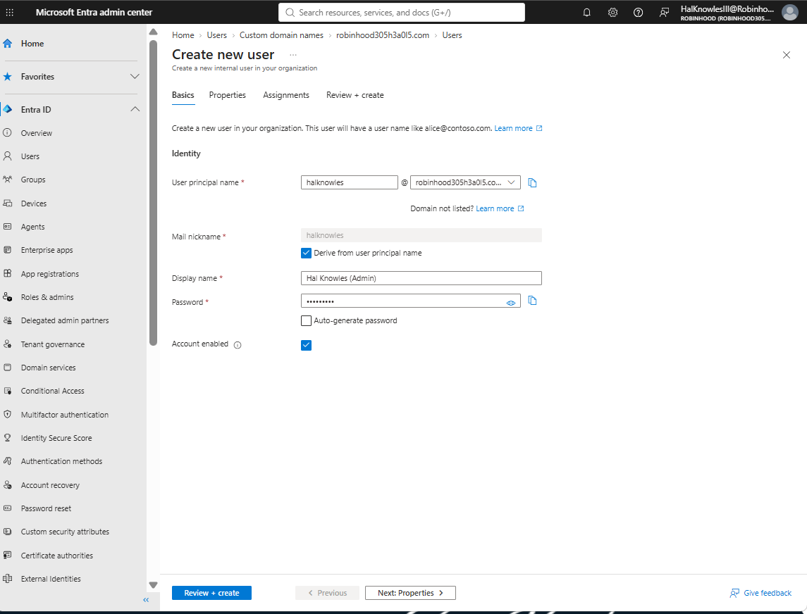
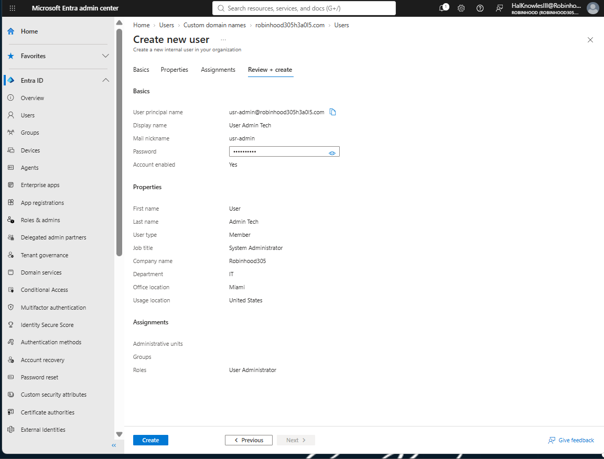
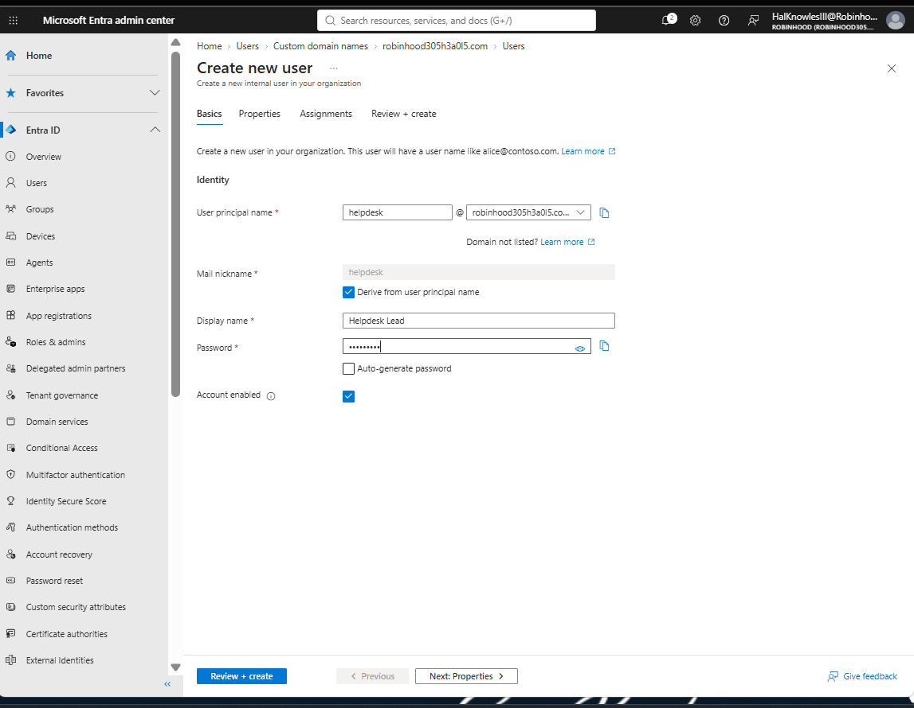
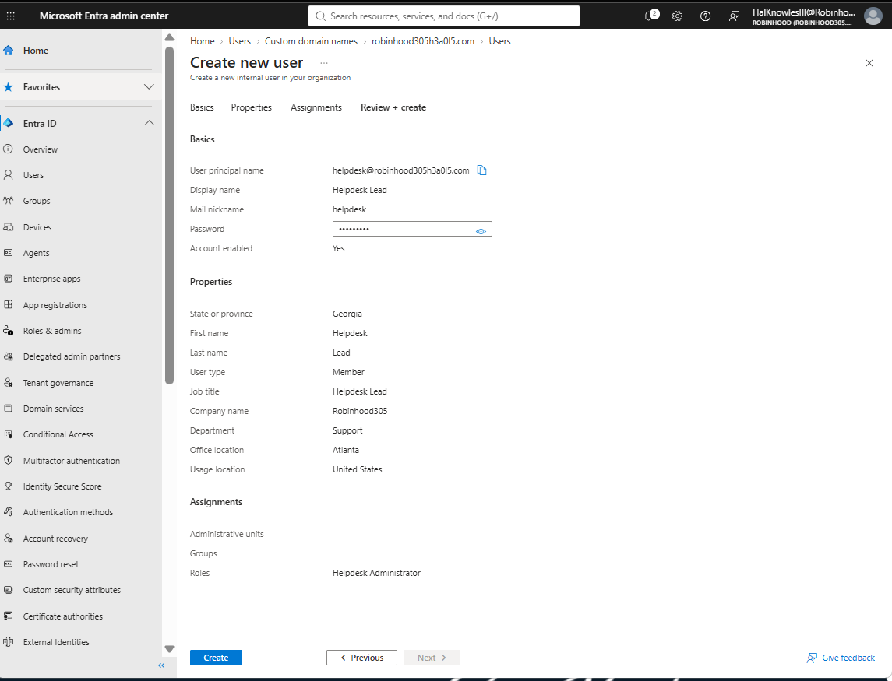
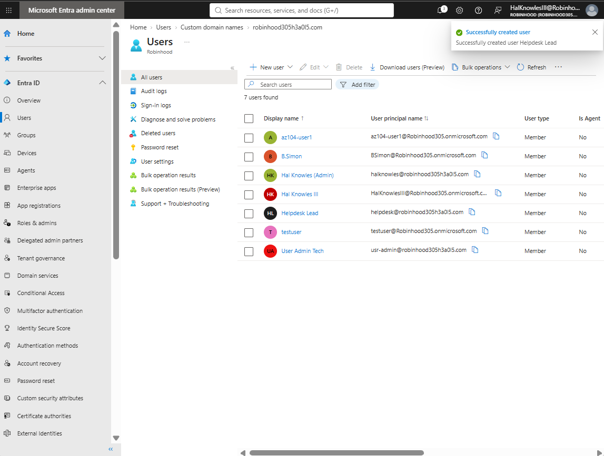

## 🚀 LAB 2: Identity Management, Custom Domain Verification, User Provisioning & Dynamic Group Governance

# Identity Management, Dynamic Groups & Group-Based Licensing

## 🎯 Executive Summary & Objectives
- **Goal:** Implement enterprise user identity management, dynamic security group provisioning, and automated group-based licensing within Microsoft Entra ID.
- **Organization Name:** Robinhood (`Robinhood305.onmicrosoft.com`)
- **Primary Domain Suffix:** `robinhood305h3a0l5.com`
- **Key Azure Services Used:** Microsoft Entra ID (Azure AD), Microsoft 365 Admin Center, Dynamic Security Groups, Group-Based Licensing.

---

## 🏗️ Architecture & Implementation Summary

### 1. Enterprise User Provisioning

Three administrative and technical user identities were established utilizing the verified primary custom domain suffix (`robinhood305h3a0l5.com`):

| Display Name | User Principal Name (UPN) | Usage Location | Department | Directory Role |
| :--- | :--- | :--- | :--- | :--- |
| **Hal Knowles (Admin)** | `halknowles@robinhood305h3a0l5.com` | United States | IT | Global Administrator |
| **User Admin Tech** | `usr-admin@robinhood305h3a0l5.com` | United States | IT | User Administrator |
| **Helpdesk Lead** | `helpdesk@robinhood305h3a0l5.com` | United States | Support | Helpdesk Administrator |

#### 👤 Account 1: Hal Knowles (Admin)

*Figure 2.1a: Initial account setup for Global Administrator identity under domain `robinhood305h3a0l5.com`.*


*Figure 2.1b: Configuration properties and Global Administrator directory role validation.*

---

#### 👤 Account 2: User Admin Tech

*Figure 2.2a: Provisioning User Administrator account with custom UPN prefix `usr-admin`.*


*Figure 2.2b: Configuration properties and User Administrator directory role validation.*

---

#### 👤 Account 3: Helpdesk Lead

*Figure 2.3a: Provisioning Helpdesk Administrator account with UPN prefix `helpdesk`.*


*Figure 2.3b: Configuration properties and Helpdesk Administrator directory role validation.*

---

#### 📋 Directory Provisioning Audit Logs & User List

*Figure 2.4a: Real-time Entra ID notification panel confirming successful provisioning sequence for all three administrative identities.*


*Figure 2.4b: Microsoft Entra ID active users directory confirming creation of custom domain user identities.*

---

### 2. Dynamic Security Group Configuration

To automate membership lifecycles and eliminate manual administrative overhead, a dynamic security group named **`Robinhood305-IT-Staff`** was provisioned:

- **Group Type:** Security
- **Membership Type:** Dynamic User
- **Role Assignable:** Disabled *(Required to allow dynamic group evaluation)*


*Figure 2.5: Microsoft Entra ID Security Group creation configured for Dynamic User evaluation.*

---

### 3. Dynamic Membership Query Definition

Membership rules were constructed in the rule builder to evaluate user profile attributes upon directory account creation:

```text
(user.department -eq "IT")
## 🚀 Next Up | Lab 3 Agenda: Enterprise Azure RBAC & Custom Role Definitions

With tenant-level identities active, **Lab 3** transitions to resource-level access governance using **Azure Role-Based Access Control (RBAC)**:

- 🔹 **Built-in Role Delegation:** Assigning targeted `Contributor` access over resource groups under least-privilege principles.
- 🔹 **Custom JSON Role Creation:** Deploying a custom `Virtual Machine Operator` role to allow starting/stopping VMs without full management access.
- 🔹 **Scope Inheritance Verification:** Validating permission inheritance across Subscription $\rightarrow$ Resource Group $\rightarrow$ Resource levels.
- 🔹 **Access Control Testing:** Verifying that unauthorized resource creation attempts are explicitly denied by Azure IAM policies.
