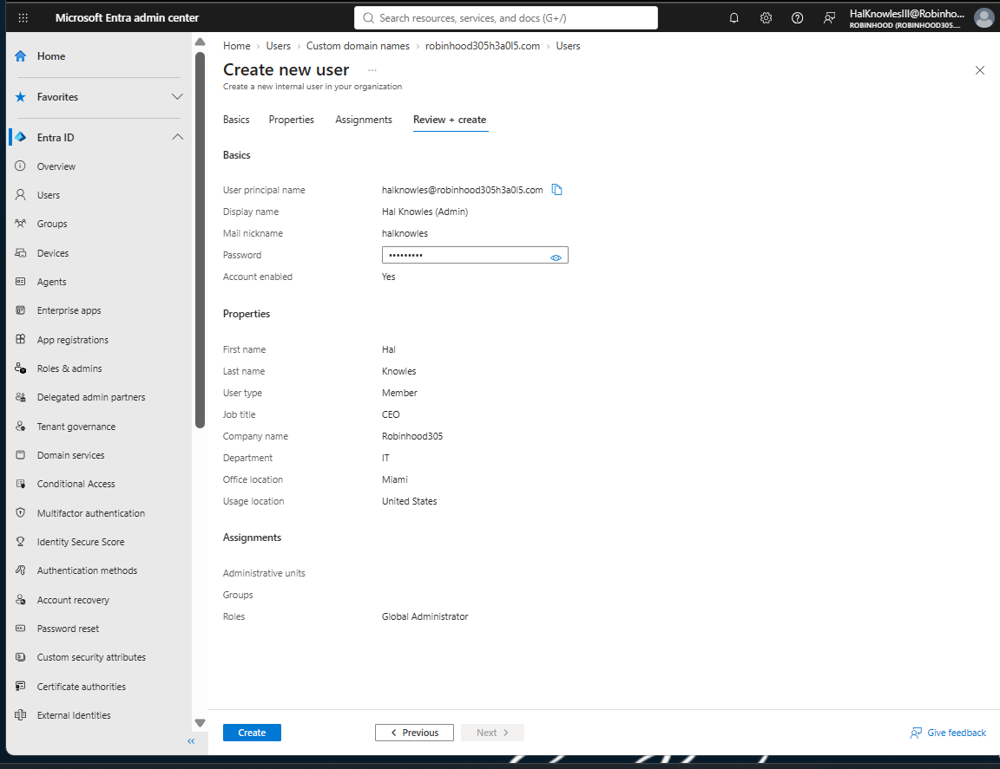
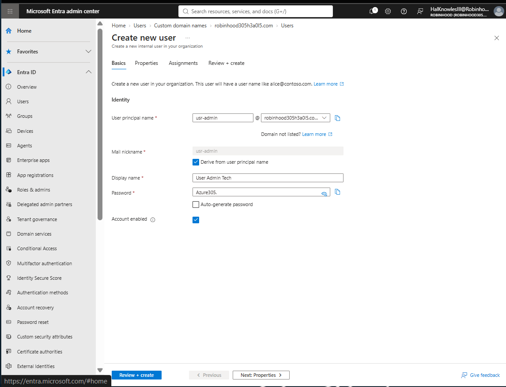
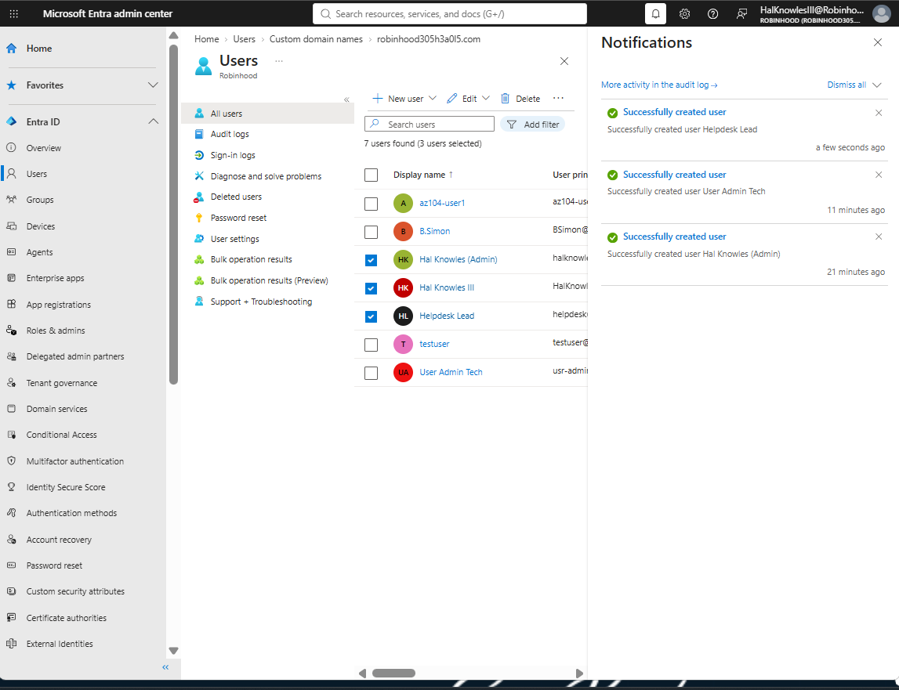
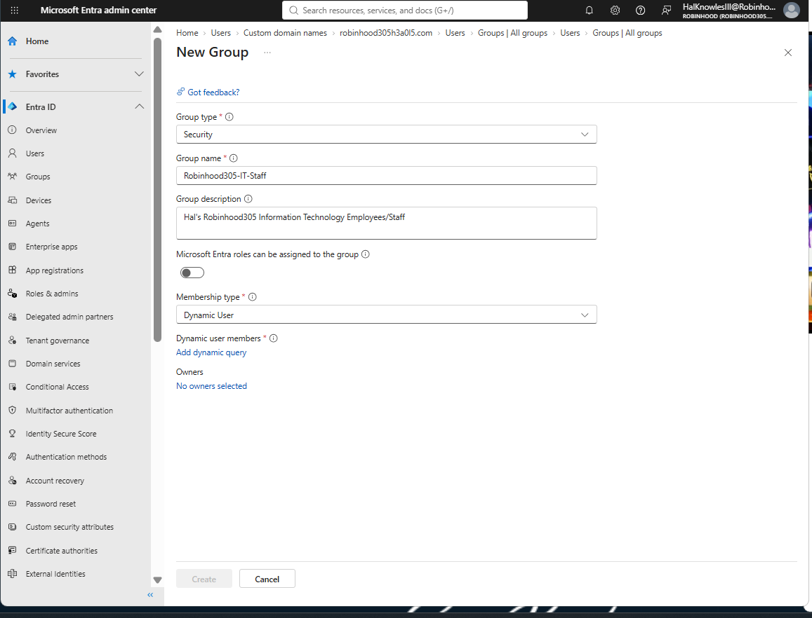
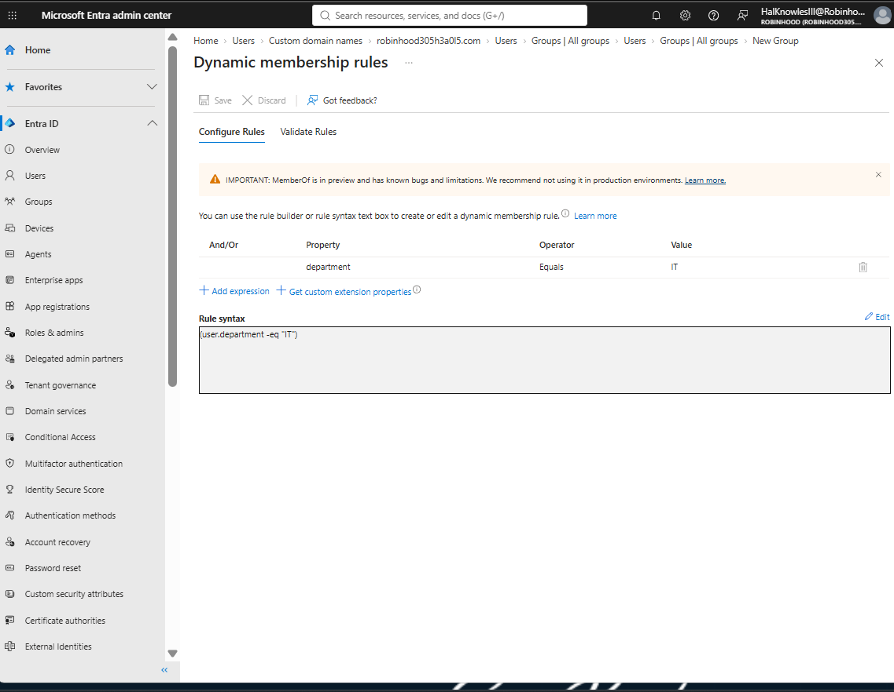
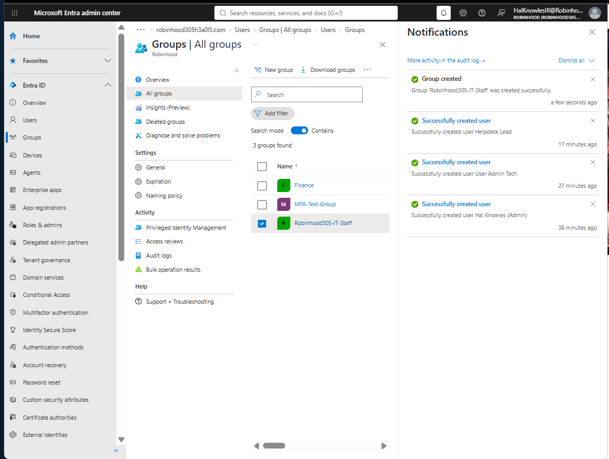

## 🚀 LAB 2: Identity Management, Custom Domain Verification, User Provisioning & Dynamic Group Governance

# Lab 2: Identity Management, Dynamic Groups & Group-Based Licensing

## 🎯 Executive Summary & Objectives
- **Goal:** Implement enterprise user identity management, dynamic security group provisioning, and automated group-based licensing within Microsoft Entra ID.
- **Organization Name:** Robinhood (`Robinhood305.onmicrosoft.com`)
- **Primary Domain Suffix:** `robinhood305h3a0l5.com`
- **Key Azure Services Used:** Microsoft Entra ID (Azure AD), Microsoft 365 Admin Center, Dynamic Security Groups, Group-Based Licensing.

---

## 🏗️ Architecture & Implementation Summary

### 1. Enterprise User Provisioning

Three administrative and technical user identities were established utilizing the verified primary custom domain suffix (`robinhood305h3a0l5.com`):

| Display Name | User Principal Name (UPN) | Usage Location | Department | Directory Role |
| :--- | :--- | :--- | :--- | :--- |
| **Hal Knowles (Admin)** | `halknowles@robinhood305h3a0l5.com` | United States | IT | Global Administrator |
| **User Admin Tech** | `usr-admin@robinhood305h3a0l5.com` | United States | IT | User Administrator |
| **Helpdesk Lead** | `helpdesk@robinhood305h3a0l5.com` | United States | Support | Helpdesk Administrator |

---

### 📷 User Provisioning Screenshots (Screenshots 1 - 8)

#### 1. Hal Knowles Admin Setup

*Figure 2.1a: Initial account setup for Global Administrator identity under domain robinhood305h3a0l5.com (Screenshot 1).*

#### 2. Hal Knowles Admin Verification

*Figure 2.1b: Configuration properties and Global Administrator directory role validation (Screenshot 2).*

---

#### 3. User Admin Tech Setup

*Figure 2.2a: Provisioning User Administrator account with custom UPN prefix usr-admin (Screenshot 3).*

#### 4. User Admin Tech Verification

*Figure 2.2b: Configuration properties and User Administrator directory role validation (Screenshot 4).*

---

#### 5. Helpdesk Lead Setup

*Figure 2.3a: Provisioning Helpdesk Administrator account with UPN prefix helpdesk (Screenshot 5).*

#### 6. Helpdesk Lead Verification

*Figure 2.3b: Configuration properties and Helpdesk Administrator directory role validation (Screenshot 6).*

---

#### 7. User Creation Notifications

*Figure 2.4a: Real-time Entra ID notification panel confirming successful provisioning sequence (Screenshot 7).*

#### 8. All Users Directory List

*Figure 2.4b: Microsoft Entra ID active users directory confirming creation of custom domain user identities (Screenshot 8).*

---

### 📷 Dynamic Security Group Screenshots (Screenshots 9 - 11)

#### 9. New Security Group Configuration

*Figure 2.5: Microsoft Entra ID Security Group creation configured for Dynamic User evaluation (Screenshot 9).*

#### 10. Dynamic Membership Rule Query Syntax

*Figure 2.6: Configuration of dynamic membership query syntax `(user.department -eq "IT")` in Entra portal (Screenshot 10).*

#### 11. All Group Creation Success Status

*Figure 2.7: Confirmation panel and active security group in the Groups directory table (Screenshot 11).*

---

## 🧪 Validation & Operational Results

- ✅ **Domain Suffix Verification:** Confirmed accounts (`halknowles`, `usr-admin`, `helpdesk`) properly generated under `robinhood305h3a0l5.com`.
- ✅ **Dynamic Query Syntax:** Confirmed dynamic rule expression `(user.department -eq "IT")` passed validation in Entra Admin Center.
- ✅ **Administrative RBAC:** Verified directory role assignments (`Global Administrator`, `User Administrator`, `Helpdesk Administrator`).
- ✅ **Group Provisioning Audit:** Confirmed `Robinhood305-IT-Staff` security group creation logged and active in the group directory.

---

## 🚀 Next Up | Lab 3 Agenda: Enterprise Azure RBAC & Custom Role Definitions

With tenant-level identities active, **Lab 3** transitions to resource-level access governance using **Azure Role-Based Access Control (RBAC)**:

- 🔹 **Built-in Role Delegation:** Assigning targeted `Contributor` access over resource groups under least-privilege principles.
- 🔹 **Custom JSON Role Creation:** Deploying a custom `Virtual Machine Operator` role to allow starting/stopping VMs without full management access.
- 🔹 **Scope Inheritance Verification:** Validating permission inheritance across Management Group $\rightarrow$ Subscription $\rightarrow$ Resource Group $\rightarrow$ Resource levels.
- 🔹 **Access Control Testing:** Verifying that unauthorized resource creation attempts are explicitly denied by Azure IAM policies.

## 🚀 Next Up | Lab 3 Agenda: Enterprise Azure RBAC & Custom Role Definitions

With tenant-level identities active, **Lab 3** transitions to resource-level access governance using **Azure Role-Based Access Control (RBAC)**:

- 🔹 **Built-in Role Delegation:** Assigning targeted `Contributor` access over resource groups under least-privilege principles.
- 🔹 **Custom JSON Role Creation:** Deploying a custom `Virtual Machine Operator` role to allow starting/stopping VMs without full management access.
- 🔹 **Scope Inheritance Verification:** Validating permission inheritance across Subscription $\rightarrow$ Resource Group $\rightarrow$ Resource levels.
- 🔹 **Access Control Testing:** Verifying that unauthorized resource creation attempts are explicitly denied by Azure IAM policies.
